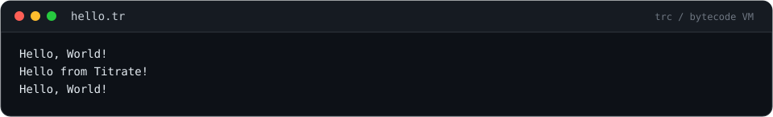
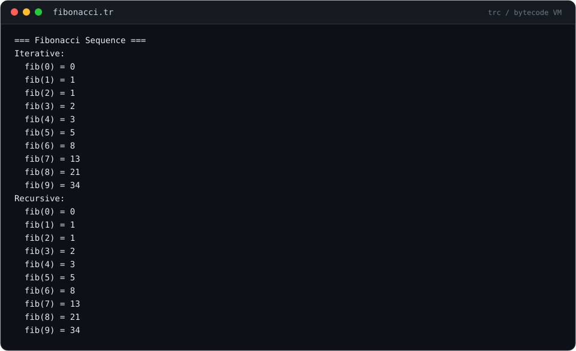
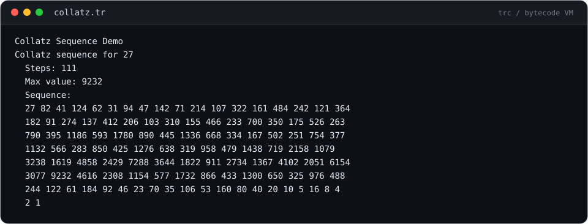
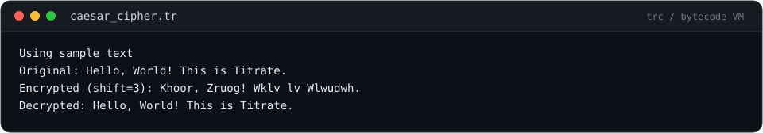
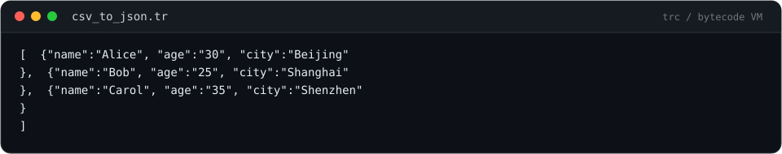
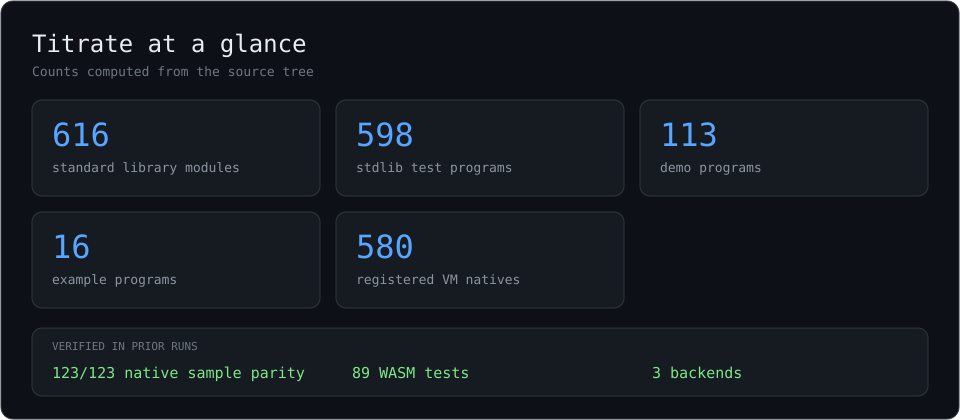

# Titrate: A Systems Programming Language with a Rust Compiler, Bytecode VM, and LLVM Native Backend

[](https://github.com/richie-rich90454/titrate/actions/workflows/ci.yml)
[](LICENSE)
[](https://www.rust-lang.org/)
[](trc/Cargo.toml)
[](pipette/Cargo.toml)
[](https://richie-rich90454.github.io/titrate/)
[](docs/guide/contributing.md)

**Titrate is a systems programming language with a Rust compiler, a bytecode VM, an LLVM native backend, and a WASM backend. It provides static types, compile-time generics, closures, ownership with region-based allocation, pattern matching, and a large standard library with built-in scientific computing.**

Write one `.tr` source file and run it on the bytecode VM for quick iteration, compile it to a standalone native executable with LLVM for deployment, or lower it to a WebAssembly module for a host application. Static types, monomorphized generics, and explicit ownership give you control over data representation and memory without a tracing garbage collector.

[Read the documentation](https://richie-rich90454.github.io/titrate/) | [Getting started](docs/guide/getting-started.md) | [What is Titrate?](docs/guide/overview.md) | [Demo gallery](docs/guide/gallery.md)

## Hello, Titrate

The complete program, in `hello.tr`:

```titrate
public fn main(): void {
    io::println("Hello, Titrate!");
}
```

Run it on the bytecode VM, or compile a native executable:

```bash
# Bytecode VM (binary is in target/release from the workspace root)
./target/release/trc hello.tr          # Linux and macOS
.\target\release\trc.exe hello.tr      # Windows PowerShell

# Native executable, produced as hello_native (or hello_native.exe)
./target/release/trc hello.tr --native --release
./hello_native                         # Linux and macOS
.\hello_native.exe                     # Windows PowerShell
```

Both paths print `Hello, Titrate!`. See the [demo gallery](docs/guide/gallery.md) for more programs with their output.

## Why Titrate

| Capability | What it gives you | Learn more |
|------------|-------------------|------------|
| Static types and precise primitives | `byte`, `half`, arbitrary-precision `vast`, and 128-bit `quad`; explicit `as` casts and `is` checks | [Type reference](docs/reference/types.md) |
| Compile-time generics | Monomorphized functions and classes, with no boxing or runtime type checks | [Generics guide](docs/guide/generics.md) |
| Ownership and regions | Move semantics, borrowing, and `region` allocation with escape diagnostics and no tracing garbage collector | [Ownership guide](docs/guide/ownership.md) |
| Closures and function types | Capturing closures, `fn(int): int` type annotations, and arrow bodies | [Closures guide](docs/guide/closures.md) |
| Pattern matching and `Result` | Exhaustive `switch` on enum payloads and `Result<T, E>` with `?` propagation | [Pattern matching](docs/guide/pattern-matching.md), [error handling](docs/guide/error-handling.md) |
| Operator overloading | Define `fn operator+` and other operators on your own types | [Operator overloading](docs/guide/operator-overloading.md) |
| Scientific standard library | Linear algebra, N-dimensional arrays, chemistry, signal processing, and machine learning in `tt` | [Scientific computing](docs/guide/scientific-computing.md) |
| Three backends | Bytecode VM, LLVM native executable, and a WASM code generator with parity tests | [Three backends](#three-backends-one-source) |

Titrate also accepts a limited set of C-style declarations and Java-style method signatures as syntax sugar; see the [syntax sugar reference](docs/guide/syntax-sugar.md).

## Quick Start

### Prerequisites

- **Rust 1.99.1** (the version pinned by CI), installed with [rustup](https://rustup.rs)
- **LLVM 22.1** development files, required by the native backend
  - Windows: install LLVM 22.1 into `C:\Program Files\LLVM\` and add it to `PATH`
  - macOS: `brew install llvm@22`
  - Linux: install `llvm-22-dev` and `libclang-22-dev`
- **MSVC Build Tools** on Windows: Visual Studio 2022 with the "Desktop development with C++" workload

See [building Titrate from source](docs/guide/building-from-source.md) for platform-specific setup.

### Build and run

```bash
git clone https://github.com/richie-rich90454/titrate.git
cd titrate
cargo build --release
```

`trc` is the compiler and VM runner; `pipette` is the build tool for multi-file projects:

```bash
# Single file
./target/release/trc examples/hello.tr

# Multi-file project
./target/release/pipette new myproject
cd myproject
../target/release/pipette run
```

Run `trc --help` to see the supported flags (`--native`, `--release`, `--emit-ir`).

### Run the tests

```bash
cargo test --all --jobs 1                              # full green gate
cargo test -p trc --test native_samples_parity --jobs 1              # 123/123 normalized stdout parity
cargo test -p trc --test wasm_conformance --jobs 1     # WASM backend parity
```

More targets are listed in [testing and continuous integration](docs/guide/contributing.md).

## Three Backends, One Source

The same `.tr` program can be executed or compiled in three ways:

1. **Bytecode VM (default).** `trc hello.tr` runs the program on Titrate's stack-based virtual machine. This is the default path for development and testing.
2. **LLVM native backend.** `trc hello.tr --native --release` emits a standalone executable named after the source stem (`hello_native`), with LLVM optimizations enabled. See the [native build guide](docs/guide/native-build.md).
3. **WASM backend.** The `trc::codegen::wasm::compile_to_wasm` API lowers a typed Titrate program to a `.wasm` binary exporting `main`, `memory`, and `heap_ptr`. Generated modules import runtime facilities from the host, so embedding one requires a small host shim; the supported constructs and current limitations are documented in the [WebAssembly backend guide](docs/guide/wasm-backend.md). There is no `trc` command-line flag for WASM output.

The bytecode and native paths are compared byte-for-byte across every eligible sample program; the WASM suite runs generated modules on `wasmi` and compares their output with the bytecode VM.

## Demo Gallery

These terminal captures were generated headlessly from real Titrate programs. Each one links to the curated gallery page, where the exact run command is listed.

| Demo | What it shows |
|------|---------------|
| [](docs/guide/gallery.md) | **Hello World** — entry point, string output, and mutable `var` declarations. Run `trc examples/hello.tr`. |
| [](docs/guide/gallery.md) | **Fibonacci** — recursion, iteration, `while` loops, and function return types. Run `trc examples/fibonacci.tr`. |
| [](docs/guide/gallery.md) | **Collatz sequence** — `ArrayList`, conditionals, and a `while` loop that tracks a running maximum. Run `trc demos/collatz.tr`. |
| [](docs/guide/gallery.md) | **Caesar cipher** — string indexing, character ranges, and modular arithmetic. Run `trc demos/caesar_cipher.tr`. |
| [](docs/guide/gallery.md) | **CSV to JSON** — file reads, `String.split`, and formatted output. Run `trc demos/csv_to_json.tr <file.csv>`. |
| [](docs/guide/gallery.md) | **Project at a glance** — toolchain versions, test suites, and verified parity counts. |

Browse all six in the [demo gallery](docs/guide/gallery.md), or see the full [list of shipped demos](docs/guide/demos.md).

## Project Status

The language is functional and under active development. `trc` is at version `0.3.0-alpha` and `pipette` is at `0.2.0`.

- **Verified baseline (2026-11-23, Windows):** `cargo build --all --jobs 1`, `cargo test --all --jobs 1` (816 unit tests in `trc`, all integration tests green, native tests run rather than ignored), `cargo clippy --all --jobs 1 -- -D warnings`, and the release native runtime build all pass. See [HANDOFF.md](HANDOFF.md) for the exact commands and results. Native stdlib parity is 200/598 and is tracked as the next major work item.
- **Native parity:** a prior run reported **123 of 123** eligible programs in `examples/` and `demos/` with byte-identical bytecode and native output. This figure has not been re-verified in the baseline above.
- **WASM parity:** the WebAssembly suite has **83** passing tests across 16 integration test files that compare generated modules against the bytecode VM on the supported feature set.

For a historical inventory of implemented modules, native functions, and tests, see the [archived capability summary](docs/SUMMARY.md). For release notes, see the [change log](docs/CHANGELOG.md). Documentation in this repository describes `trc` 0.3.0-alpha.

## Documentation

- [What is Titrate?](docs/guide/overview.md) — language overview, use cases, and frequently asked questions
- [Getting started](docs/guide/getting-started.md) — installation and the first program
- [Demo gallery](docs/guide/gallery.md) — six runnable examples with generated screenshots
- [Building from source](docs/guide/building-from-source.md) — prerequisites and build commands for each platform
- [Language guide](docs/guide/variables.md) — variables, functions, classes, enums, and control flow
- [Ownership and regions](docs/guide/ownership.md) — memory safety model
- [LLVM native backend](docs/guide/native-intro.md) — native compilation and C interoperability
- [WebAssembly backend](docs/guide/wasm-backend.md) — supported constructs, host imports, and limitations
- [Standard library reference](docs/guide/stdlib.md) — modules shipped with Titrate
- [Frequently asked questions](docs/guide/faq.md) — common questions and troubleshooting

The same material is published at the [Titrate documentation site](https://richie-rich90454.github.io/titrate/).

## Contributing

Contributions to the compiler, virtual machine, standard library, documentation, and examples are welcome. Start with the [contributing guide](docs/guide/contributing.md), then open an issue or a pull request on [GitHub](https://github.com/richie-rich90454/titrate). Bug reports with a small `.tr` reproduction are especially useful.

## License

Titrate is released under the [Apache License 2.0](LICENSE).
