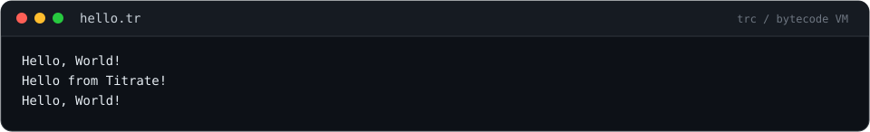
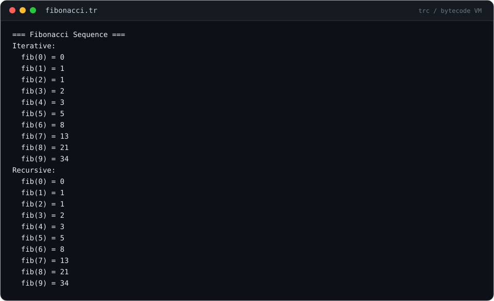
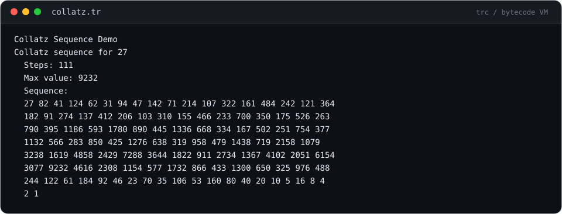
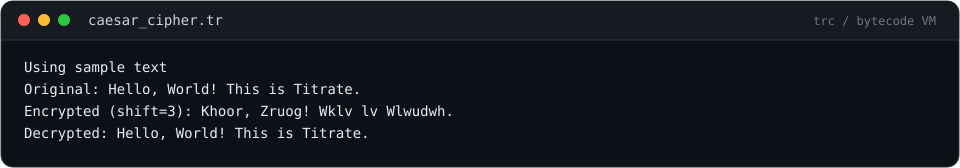
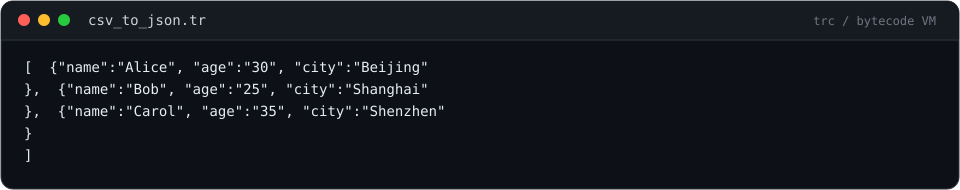
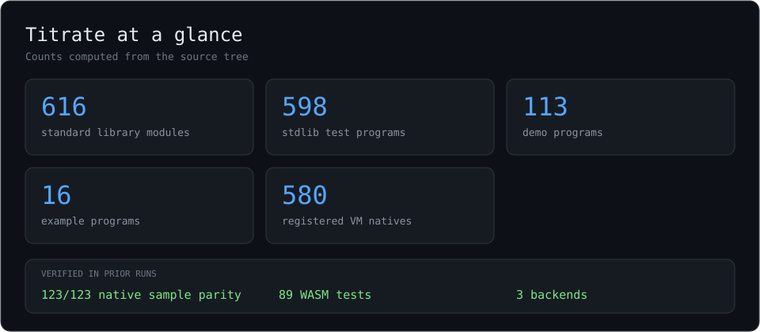

# Titrate Demo Gallery: Runnable Examples with Screenshots

This gallery collects six snapshots of Titrate programs running. Every terminal capture was generated headlessly from real `.tr` source compiled with `trc`, the Rust compiler and bytecode VM. Each entry explains what the program demonstrates and gives the exact command to reproduce its output from the repository root.

For the full set of shipped programs, see [Demo Programs](./demos). To install the toolchain first, follow [Getting Started](./getting-started). All commands below use the bytecode VM; add `--native --release` to any of them to build a native executable instead.

## Hello World



The smallest complete Titrate program. It declares the `main` entry point with an explicit `void` return type, prints a string literal through `io::println`, then uses `let` for an inferred-type value and `var` for a mutable one.

```bash
trc examples/hello.tr
```

Read the line-by-line walkthrough in [Your First Program](./getting-started#your-first-program).

## Fibonacci Sequence



Two implementations of the same function side by side. The iterative version keeps state in local `var` values inside a `while` loop; the recursive version calls itself, demonstrating explicit return types and `if` branches. Both produce the same first ten values.

```bash
trc examples/fibonacci.tr
```

See [Functions](./functions) and [Control Flow](./control-flow) for the syntax used here.

## Collatz Sequence



Given a starting integer (27 by default), this program follows the Collatz rules until the value reaches 1. It stores the whole sequence in an `ArrayList<int>`, tracks the step count and the maximum value, and wraps long output into lines. It is an example of collection use, command-line arguments through `Sys_args()`, and loop-carried state.

```bash
trc demos/collatz.tr
```

Without arguments the demo uses 27 as the starting value.

See [Ownership and Regions](./ownership) for how Titrate manages the collection's memory.

## Caesar Cipher



A classic text transformation. The program reads a file when one is supplied and otherwise uses a built-in sample string, shifts alphabetic characters by a configurable amount, and prints the original, encrypted, and decrypted text. It exercises character ranges from `String.charAt`, modular arithmetic, and `Sys_args()`.

```bash
trc demos/caesar_cipher.tr
```

The optional arguments are an input filename and an integer shift (the default shift is 3):

```bash
trc demos/caesar_cipher.tr input.txt 3
```

See [Strings & Literals](./raw-strings) and [File I/O](./file-io).

## CSV to JSON



A small data-conversion tool. It reads a CSV file, splits the header row and each data row with `String.split`, and writes a JSON array of objects to standard output. This demo shows file reads, trimming, nested loops, and formatted `io::print` calls.

```bash
trc demos/csv_to_json.tr <file.csv>
```

Run it without arguments to print its usage message:

```bash
trc demos/csv_to_json.tr
```

See [File I/O](./file-io) and the [JSON module reference](../stdlib/json).

## Project at a Glance



This graphic summarizes the repository state documented in the main [README](https://github.com/richie-rich90454/titrate#readme): `trc` 0.3.0-alpha, `pipette` 0.2.0, verified build/test/Clippy gates, 83 WebAssembly tests, and a 123/123 native sample parity figure reported by a prior run. It is a generated summary rather than a program screenshot, so there is no command to run. The underlying figures come from the [verified baseline](https://github.com/richie-rich90454/titrate/blob/main/HANDOFF.md) and the [WebAssembly backend guide](./wasm-backend); the [capability summary](../SUMMARY) is an archived snapshot.

## Next Steps

- Install the toolchain with [Building Titrate from Source](./building-from-source).
- Work through the [Getting Started guide](./getting-started) to write your own programs.
- Learn how the [bytecode VM](./architecture), [LLVM native backend](./native-intro), and [WASM backend](./wasm-backend) differ.
- Browse the [full demo list](./demos) and the [standard library reference](../stdlib/lang).
