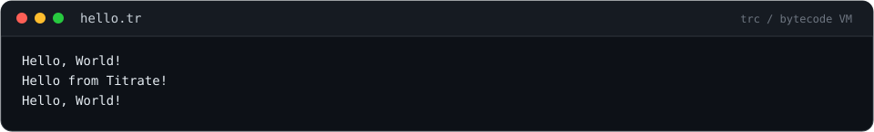

## Titrate Language at a Glance: Syntax, Types, and Generics

```titrate
// Variables -- let for mutable with inference, var for explicit type
let name = "Titrate";
var count: int = 0;

// Functions with name: Type parameter order
public fn greet(name: string): void {
    io::println("Hello, " + name);
}

// Classes with fn init() constructors
public class Point {
    public double x;
    public double y;

    public fn init(x: double, y: double) {
        this.x = x;
        this.y = y;
    }
}

// Generics with monomorphization -- zero runtime overhead
public class Box<T> {
    public T value;
    public fn init(value: T) { this.value = value; }
}

// Result-based error handling -- no exceptions
fn parseAndDouble(s: string): Result<int, string> {
    let n = Integer.parseInt(s);
    if (n == 0 && s != "0") {
        return err("not a number");
    }
    return ok(n * 2);
}

// Operator overloading
public class Vec2 {
    public double x;
    public double y;

    public fn init(x: double, y: double) {
        this.x = x;
        this.y = y;
    }

    public fn operator+(other: Vec2): Vec2 {
        return new Vec2(this.x + other.x, this.y + other.y);
    }
}

// Ranges and iterators
for (i in 0..10) {
    io::println(Integer.toString(i));
}
```

## Quick Start: Install, Build, and Run Titrate

```bash
# Clone and build
git clone https://github.com/richie-rich90454/titrate.git
cd titrate
cargo build --release

# Create and run your first program with the bytecode VM
echo 'public fn main(): void { io::println("Hello, Titrate!"); }' > hello.tr
./target/release/trc hello.tr          # Linux and macOS
.\target\release\trc.exe hello.tr      # Windows PowerShell

# Or compile a native executable with LLVM
./target/release/trc hello.tr --native --release
./hello_native                         # Linux and macOS
.\hello_native.exe                     # Windows PowerShell
```

For platform-specific prerequisites, see [Building from Source](./guide/building-from-source). Running `trc --help` lists the supported flags.

## Why Titrate? Design and Use Cases

For a high-level introduction to the language, its design, and answers to common questions, see [What Is Titrate?](./guide/overview). For working programs and their output, open the [demo gallery](./guide/gallery).

### Type Safety Without Runtime Type Checks

Titrate's monomorphizing compiler generates specialized code for each generic type instance. `ArrayList<int>` uses no boxing and performs no runtime type checks.

### Memory Safety Without Garbage Collection

Ownership semantics, move checking and region-based allocation give you memory safety guarantees without a tracing garbage collector.

### Clean, Modern Syntax

Inspired by Rust and Python, Titrate uses `name: Type` parameter order, `fn` declarations and lowercase `string` from the start. C-family sugar forms (`int x = 5`, `++i`, `ClassName(params)`) make developers from C, C++ and ECMAScript feel at home immediately.

### Scientific Computing Built in

Chemistry simulations, bioinformatics, physics engines, machine learning, signal processing, image/audio processing, computational geometry, NLP, HFT and discrete-event simulation are all part of the standard library.

## See Titrate in Action

The [demo gallery](./guide/gallery) shows six programs with terminal captures generated from real Titrate source: hello world, Fibonacci, the Collatz sequence, a Caesar cipher, CSV-to-JSON conversion, and a project-at-a-glance summary. Each entry includes the exact `trc` command to run it.



## Comparison

### Molecular Dynamics Force Calculation

**Titrate** - Memory safe, zero-cost generics, scientific stdlib built in:

```titrate
import tt::chem::Atom;
import tt::math::MathAdvanced;

public fn ljForce(a: Atom, b: Atom): double {
    let dx = b.x - a.x;
    let dy = b.y - a.y;
    let dz = b.z - a.z;
    let r2 = dx * dx + dy * dy + dz * dz;
    let r6 = MathAdvanced.pow(r2, 3.0);
    let r12 = r6 * r6;
    let sig6 = MathAdvanced.pow(a.sig, 6.0);
    let sig12 = sig6 * sig6;
    return 24.0 * a.eps * (2.0 * sig12 / r12 - sig6 / r6) / r2;
}
```

**Python** - Simple syntax, with garbage collection:

```python
def lj_force(a, b):
    dx = b.x - a.x
    dy = b.y - a.y
    dz = b.z - a.z
    r2 = dx*dx + dy*dy + dz*dz
    r6 = r2 ** 3
    r12 = r6 * r6
    sig6 = a.sig ** 6
    sig12 = sig6 * sig6
    return 24.0 * a.eps * (2.0 * sig12 / r12 - sig6 / r6) / r2
```

**C++** - Fast, but manual memory management, no safety:

```cpp
double lj_force(Atom* a, Atom* b) {
    double dx = b->x - a->x;
    double dy = b->y - a->y;
    double dz = b->z - a->z;
    double r2 = dx*dx + dy*dy + dz*dz;
    double r6 = r2 * r2 * r2;
    double r12 = r6 * r6;
    double sig6 = a->sig * a->sig * a->sig * a->sig * a->sig * a->sig;
    double sig12 = sig6 * sig6;
    return 24.0 * a->eps * (2.0 * sig12 / r12 - sig6 / r6) / r2;
}
```

| Feature | Titrate | Python | C++ |
|---------|---------|--------|-----|
| Memory Safety | Yes (ownership) | Yes (GC) | No |
| Garbage Collector | No | Yes | No |
| Zero-Cost Generics | Yes | No | Partial |
| Scientific Stdlib | Built-in | External packages | External libraries |
| Error Handling | Result`T,E` | Exceptions | Exceptions/codes |
| Native executable | Optional LLVM backend | Standard toolchain | Third-party tools |
| WASM backend | Library code generator with parity tests | Third-party toolchains | Third-party toolchains |